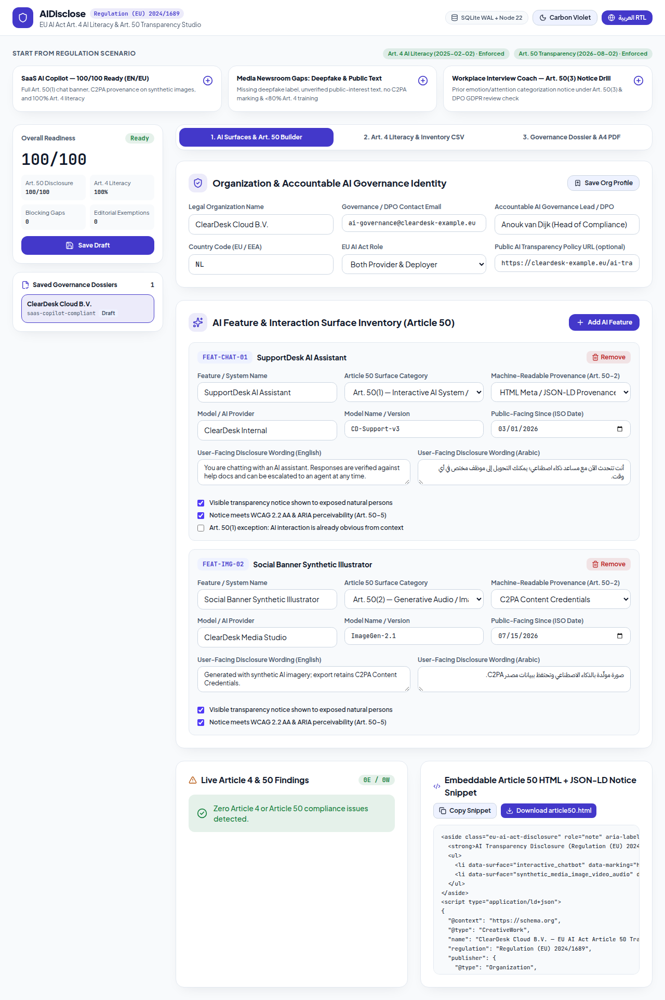
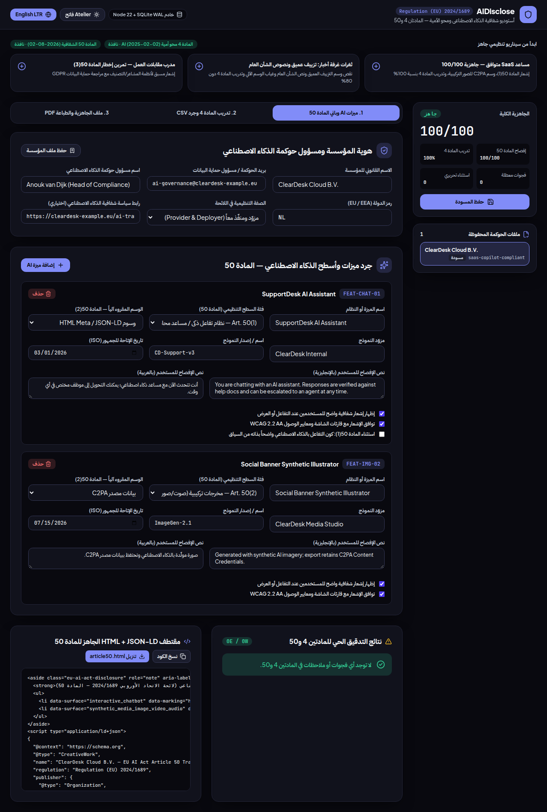
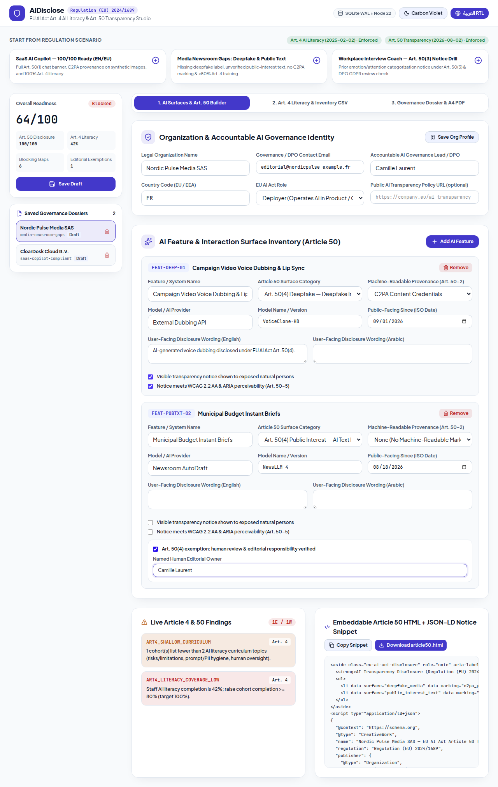
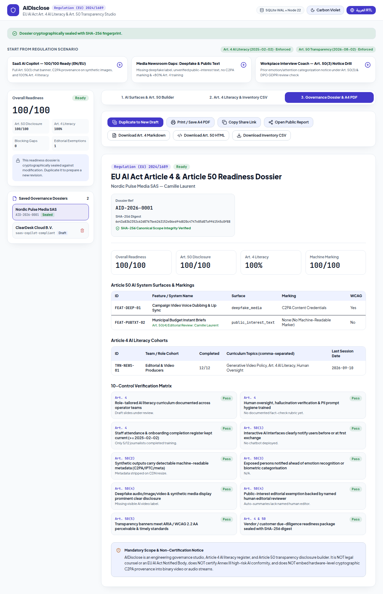
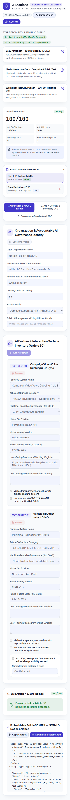
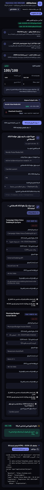

# AIDisclose — EU AI Act (Regulation (EU) 2024/1689 Art. 4 & 50) Readiness Studio

[](https://github.com/manea/aidisclose/actions/workflows/ci.yml)
[](LICENSE)
A **$0, privacy-first** governance studio, **Article 4 AI Literacy staff training register** (enforceable since **2 February 2025**), and **Article 50 transparency notice builder & bulk AI inventory auditor** (enforceable since **2 August 2026**) for **Regulation (EU) 2024/1689**.

> **Mandatory Legal Disclaimer:** AIDisclose is an engineering governance studio, Article 4 AI literacy register, and Article 50 transparency disclosure builder. It is **NOT** legal counsel or an EU AI Act **Notified Body**, does **NOT** certify `Annex III` high-risk AI conformity, and does **NOT** embed hardware-level cryptographic `C2PA` provenance into binary video or audio streams.

---

## Key Capabilities

- **Article 50 AI Surface Transparency Builder & Auditor**:
  - Audits all five regulatory surfaces: interactive AI chatbots (`Art. 50(1)` with context-obviousness check), generative media marking (`Art. 50(2)`: `C2PA`, `IPTC`, `HTML Meta/JSON-LD`, audio watermarking), emotion recognition / biometric categorisation notices (`Art. 50(3)`), deepfake & public-interest synthetic text (`Art. 50(4)` including the named human editorial review exemption), and WCAG 2.2 AA notice accessibility (`Art. 50(5)`).
  - Generates an **XSS-safe HTML + JSON-LD disclosure snippet** (`buildArticle50NoticeHtmlSnippet`) ready for SaaS chat UIs, websites, or media pages.
- **Article 4 AI Literacy Staff Training Register (`>= 2025-02-02`)**:
  - Tracks team cohorts, headcount completion coverage (`80%` threshold & `100%` readiness), multi-topic curricula (hallucination verification, prompt/PII hygiene, human oversight), and exports **Article 4 Literacy & Inventory Markdown** dossiers (`EN` & `AR`).
- **Bulk AI Feature Inventory CSV Auditor (`UTF-8 BOM` & Formula-Safe)**:
  - Audits multi-product AI inventories 100% locally in browser or via optional API.
  - Exports RFC-4180 CSV reports with UTF-8 BOM and formula-injection sanitization (`=`, `+`, `-`, `@` cells prefixed with `'`).
- **10-Control Readiness Matrix & SHA-256 Sealing (`AID-YYYY-0001`)**:
  - Evaluates weighted overall readiness (`ready`, `needs_remediation`, `blocked`) and seals immutable dossiers with atomic numbering and cryptographic `SHA-256` integrity verification, plus **A4 PDF** print reports and read-only `/r/:slugOrNumber` share views.
- **Bilingual & Dual-Theme UI**: Full **English (`LTR`)** and **Arabic (`RTL`)** with **Veridian Atelier & Iris** (light) and **Carbon Violet** (dark).

---


## UI Previews

### Workspace — English LTR (`Veridian Atelier & Iris`)


### Dual-Script Workspace — Arabic RTL (`Carbon Violet Dark`)


### Remediated Deepfake, Art. 50(4) Editorial Exemption & Live HTML Snippet


### Sealed Readiness Dossier (`AID-YYYY-0001` & SHA-256 Digest)


### Mobile English LTR View (`390x844`)


### Mobile Arabic RTL View (`Carbon Violet Dark`, `390x844`)


---
## Local Development (`Node 22+`)

```bash
npm install
npm run dev          # Vite frontend (:5173, proxies /api -> :4197)
npm start            # Node 22 + SQLite WAL server (:4197)
npm run typecheck    # Strict TypeScript check
npm test             # Core + Server integration tests (Vitest)
npm run build        # Production static bundle in ./dist
npm run test:e2e     # Real Chrome Playwright E2E tests (:4198)
```

---

## Zero-Budget Deployment Options (`$0/month`)

### Option 1: Cloudflare Workers Static Assets (`wrangler.jsonc`)
All AI transparency audits, bulk inventory CSV checks, Article 50 HTML snippet generation, SHA-256 sealing, and A4 PDF printing run 100% locally in the browser using `localStorage` with zero backend required:

```bash
npm run build
npx wrangler login
npx wrangler deploy
```

### Option 2: Self-Hosted Docker / Node 22 + SQLite WAL

```bash
docker compose up -d --build
# Reverse proxy 127.0.0.1:4197 via deploy/Caddyfile (supports optional BASE_PATH=/aidisclose)
```

---

## HTTP API Summary (Optional Backend `:4197`)

| Method & Path | Purpose |
| :--- | :--- |
| `GET /api/health` | Service status, version, `basePath`, dossier & org profile counts |
| `GET /api/presets` | Built-in EU AI Act Article 4 & 50 scenario presets |
| `POST /api/audit-transparency` | Stateless Art. 4 & 50 evaluation + Art. 50 HTML / Art. 4 Markdown |
| `POST /api/inventory-audit` | Bulk AI feature CSV validation + formula-safe UTF-8 BOM CSV export |
| `GET/POST/PATCH/DELETE /api/profiles` | Reusable Organization / AI Governance / DPO profiles CRUD |
| `GET/POST /api/dossiers` | List & create editable draft governance dossiers |
| `GET/PATCH/DELETE /api/dossiers/:id` | Read, update draft, or delete unsealed draft (`409` if locked) |
| `POST /api/dossiers/:id/duplicate` | Clone any draft or locked dossier into a fresh editable draft |
| `POST /api/dossiers/:id/finalize` (`or /lock`) | Atomically seal as `AID-YYYY-0001` with `SHA-256` digest |
| `GET /api/dossiers/:id/article50.html` | Download embeddable Article 50 HTML + JSON-LD snippet (`?locale=en\|ar`) |
| `GET /api/dossiers/:id/literacy.md` | Download Article 4 Literacy & Inventory Markdown (`?locale=en\|ar`) |
| `GET /api/dossiers/:id/export.csv` | Download formula-safe UTF-8 BOM CSV report |
| `GET /api/dossiers/:id/summary` | Concise bilingual governance brief (`?locale=en\|ar`) |
| `GET /api/public/reports/:slugOrNumber` | Shareable read-only compliance dossier endpoint with view counter |

## License

MIT
